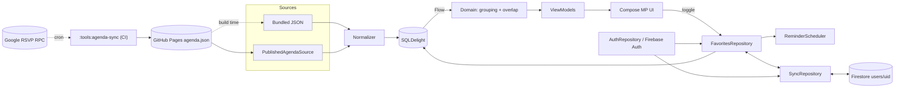
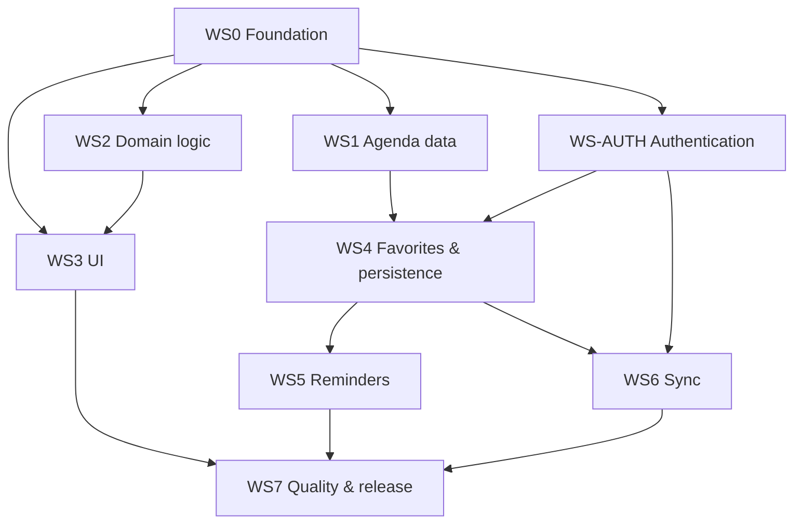

# PRD: ADS Planner — Android Dev Summit Companion (Kotlin Multiplatform)

| | |
|---|---|
| **Status** | Draft v0.2 (agenda source spike done — see [ADR-0001](adr/0001-agenda-source.md)) |
| **Owner** | cybo42 |
| **Last updated** | 2026-10-09 |
| **Platforms** | Android, iOS (Compose Multiplatform); Desktop JVM as stretch/dev target |
| **References** | [Kotlin Multiplatform](https://kotlinlang.org/multiplatform/) · [ADS Bayview agenda](https://rsvp.withgoogle.com/events/android-dev-summit-bayview/agenda) |

---

## 1. Overview

### 1.1 Problem
Android Dev Summit runs multiple tracks in parallel. Attendees have to scan a web agenda, mentally work out which talks clash, keep a separate list of what they want to see, and set their own alarms. The official page is not optimised for building a personal plan, flagging clashes, or reminding you to change rooms.

### 1.2 Vision
A small, fast, offline-first mobile app that lets an attendee:
1. Browse the agenda **day by day**, with sessions that run at the same time **grouped and flagged**.
2. **Favorite** sessions to build a personal schedule and see **conflicts** between favorites.
3. Get a **reminder notification** shortly before each favorited session.
4. Optionally **sync** their plan across devices (e.g. phone + tablet, Android + iPhone).

### 1.3 Target user
- **Primary:** an in-person ADS attendee (developer) planning ahead and navigating the venue on the day.
- **Secondary:** a remote viewer following the livestream, using the app as a "what's on next" guide.

### 1.4 Success metrics
| Metric | Target |
|---|---|
| Time to build a full-event plan (first launch → all favorites set) | < 5 minutes |
| Favorited sessions missed because of no/late reminder | 0 |
| Reminder delivery accuracy | within ±30 s of scheduled time (Android exact alarm), ±60 s iOS |
| Crash-free sessions | ≥ 99.5 % |
| Cold start to agenda visible (cached data) | < 2 s on a mid-range device |
| Cross-device sync latency (both devices online) | < 5 s |

---

## 2. Goals and non-goals

### 2.1 Goals (v1)
- G1 — Daily agenda view with clear clash detection.
- G2 — Favorites and a personal "My Schedule" view.
- G3 — Reliable local reminder notifications.
- G4 — Required sign-in (Firebase Auth) giving every user an identity.
- G5 — Optional cross-device sync of favorites and reminder settings.
- G6 — Works fully offline after first sign-in and agenda download.
- G7 — Shared business logic and UI across Android and iOS via KMP + Compose Multiplatform.
- *Stretch* G8 — Cloud-hosted agenda service with pushed updates (§4.9), reusing the v1 ingestion code.

### 2.2 Non-goals (v1)
- Ticketing, RSVP, or badge management.
- Social features (sharing schedules, seeing friends' plans, chat).
- In-app video or livestream playback (link out only).
- Editing or submitting to the official agenda.
- Web (Wasm/JS) target.
- Venue maps and indoor navigation (possible v2).
- Supporting conferences other than ADS (the design should not block it, but no v1 work goes to it).

---

## 3. Personas and user stories

**Priya — in-person attendee.** Arrives on Day 1 with a list of topics (Compose, KMP, performance). She wants to star talks the night before, see where she has double-booked, and get a nudge to walk to the next room.

**Sam — multi-device attendee.** Plans on a tablet at home, uses a phone at the venue. Expects the same favorites on both.

| ID | As a… | I want to… | So that… |
|---|---|---|---|
| US-1 | attendee | see each day's sessions grouped by time slot | I can understand what is on at any moment |
| US-2 | attendee | see at a glance which sessions overlap | I can choose between clashing talks |
| US-3 | attendee | filter by track, room, format, or favorites | I can find relevant talks quickly |
| US-4 | attendee | search by title, speaker, or tag | I can jump to a talk I heard about |
| US-5 | attendee | star a session | it is added to my personal schedule |
| US-6 | attendee | see a warning when two favorites clash | I can resolve the conflict ahead of time |
| US-7 | attendee | get a notification N minutes before a favorite starts | I don't miss it and have time to change rooms |
| US-8 | attendee | change the reminder lead time globally or per session | reminders fit my walking time |
| US-9 | attendee | sign in with my Google or Apple account | my plan is tied to me |
| US-10 | multi-device user | turn on sync | my favorites show up on all my devices |
| US-11 | attendee | use the app with no connection | it works on flaky conference Wi‑Fi |
| US-12 | attendee | be told if a favorited session's time or room changes | I'm not caught out by agenda updates |
| US-13 | user | sign out and delete my account | I control my data |

---

## 4. Functional requirements

Priority: **P0** = must ship for v1, **P1** = should ship, **P2** = nice to have.

### 4.1 FR-AG — Agenda (daily view)

| ID | Requirement | Priority |
|---|---|---|
| FR-AG-1 | Show one tab per conference day, labeled with weekday and date. Default to "today" during the event, otherwise Day 1. | P0 |
| FR-AG-2 | Within a day, list sessions in chronological order, **grouped into time-slot sections** by start time. | P0 |
| FR-AG-3 | Session card shows title, start–end time, track chip (the source has **no room field**; the 4 tracks are the parallel lanes), speaker name(s), format (talk, workshop, keynote, AMA, hackathon, break), and favorite toggle. Room is shown only if the source adds it later. | P0 |
| FR-AG-4 | Tapping a card opens Session Detail: full description (sanitized HTML → rich text), session code (e.g. `ADS26_035`), speakers (name, title, company, photo, social links — the source has no bios), track, links, favorite toggle, reminder override, and a "Reserve on official site" link-out. | P0 |
| FR-AG-5 | Times shown in **venue time zone (America/Los_Angeles)** by default, with a setting to show device-local time. The time zone in use is always labeled. | P0 |
| FR-AG-6 | Filter sheet: track, format, favorites only (room and level only if the source provides them). Active filters shown as removable chips; filter state kept per session of use. | P1 |
| FR-AG-7 | Search across title, description, speaker name, and tags; results grouped by day. | P1 |
| FR-AG-8 | "Now" / "Up next" indicator during the event; auto-scroll to the current time slot when opening today's tab. | P1 |
| FR-AG-9 | Pull-to-refresh triggers an agenda refresh (see FR-DATA). | P1 |
| FR-AG-10 | Non-session items (breaks, lunch, registration) shown in a muted style and excluded from conflict detection. | P1 |

### 4.2 FR-OV — Overlap and conflict detection

**Definition:** sessions A and B overlap when `A.start < B.end && B.start < A.end` (half-open intervals, so a session ending at 10:00 does **not** overlap one starting at 10:00).

| ID | Requirement | Priority |
|---|---|---|
| FR-OV-1 | In the daily view, sessions that overlap are visually grouped (shared slot header or a side bracket showing "3 sessions in parallel"). | P0 |
| FR-OV-2 | Sessions that start at different times but still overlap (partial overlaps) are marked with an "overlaps with N" indicator listing those sessions. | P0 |
| FR-OV-3 | When ≥ 2 **favorited** sessions overlap, each shows a **conflict badge**, and the day tab shows a conflict count. | P0 |
| FR-OV-4 | My Schedule view lists favorites chronologically and draws conflicting favorites side by side, with the overlap length shown (e.g. "overlaps 20 min"). | P0 |
| FR-OV-5 | Resolve action on a conflict: "Keep this one" (unfavorites the others) or "Keep both" (stops showing the warning for that pair; stored as an acknowledged conflict). | P1 |
| FR-OV-6 | Overlap computation is pure shared Kotlin, O(n log n) per day (sort + sweep), and recomputed reactively when agenda or favorites change. | P0 |
| FR-OV-7 | Optional "travel buffer": treat sessions in different rooms that are less than X minutes apart as a soft conflict (warning, not error). Default off. | P2 |

### 4.3 FR-FV — Favorites

| ID | Requirement | Priority |
|---|---|---|
| FR-FV-1 | Toggle favorite from card, detail, and search results; the change is visible immediately (optimistic local write). | P0 |
| FR-FV-2 | Favorites persist in the local database, scoped to the signed-in `uid`. | P0 |
| FR-FV-3 | My Schedule tab: favorites by day, with conflicts highlighted (FR-OV-4) and gaps shown as free time. | P0 |
| FR-FV-4 | Favorites are keyed by the stable upstream session ID and kept through agenda refreshes. | P0 |
| FR-FV-5 | If a favorited session is **removed** upstream it is shown as "no longer on the agenda" (not silently deleted). If its **time/room changes**, the user is notified (see FR-DATA-5). | P1 |
| FR-FV-6 | Export My Schedule to the device calendar (.ics / platform calendar intent). | P2 |

### 4.4 FR-RM — Reminders

| ID | Requirement | Priority |
|---|---|---|
| FR-RM-1 | Favoriting a session schedules a local notification at `start − leadTime`; unfavoriting cancels it. | P0 |
| FR-RM-2 | Global lead time default **10 min**, options 5 / 10 / 15 / 30; per-session override on Session Detail; option to turn reminders off globally. | P0 |
| FR-RM-3 | Notification content: session title, room, start time; for a conflict, "also starting: X". Tapping it deep-links to Session Detail. | P0 |
| FR-RM-4 | Reminders are reconciled (re-scheduled or cancelled) whenever the agenda refreshes with time changes, lead time changes, favorites sync in from another device, or the app is reinstalled or restored. | P0 |
| FR-RM-5 | Reminders for sessions already in the past, or whose trigger time has passed, are not scheduled. | P0 |
| FR-RM-6 | Ask for notification permission in context (on first favorite or during onboarding), never at cold launch without explanation. If denied, show a non-blocking banner in My Schedule with a link to system settings. | P0 |
| FR-RM-7 | **Android:** use `AlarmManager.setExactAndAllowWhileIdle` when exact-alarm permission is available (`USE_EXACT_ALARM` / `SCHEDULE_EXACT_ALARM`, checking `canScheduleExactAlarms()`); otherwise fall back to inexact alarms and tell the user. Request `POST_NOTIFICATIONS` (API 33+). Re-schedule on `BOOT_COMPLETED`, `TIME_SET`, `TIMEZONE_CHANGED`, and app update. Dedicated notification channel "Session reminders". | P0 |
| FR-RM-8 | **iOS:** use `UNUserNotificationCenter` with `UNCalendarNotificationTrigger`. Because iOS allows at most **64 pending notifications**, schedule the nearest ≤ 60 and top up on app foreground or background refresh. | P0 |
| FR-RM-9 | Reminders are device-local; sync only carries favorites and preferences. Each device schedules its own reminders. A per-device "reminders on this device" toggle lets a tablet stay quiet. | P1 |
| FR-RM-10 | Optional second "starting now" notification. | P2 |

### 4.5 FR-AU — Authentication (required)

| ID | Requirement | Priority |
|---|---|---|
| FR-AU-1 | On first launch, an onboarding/auth gate blocks app content until the user signs in with **Firebase Auth**. | P0 |
| FR-AU-2 | Providers: **Google Sign-In** (Android via Credential Manager, iOS via GoogleSignIn SDK); **Sign in with Apple** on iOS (needed for App Store compliance when offering third-party login); **email link (passwordless)** as fallback. | P0 (Google, Apple), P1 (email link) |
| FR-AU-3 | Auth state persists across launches; the Firebase SDK refreshes tokens. If the device is offline on a later launch, the cached user is used and the app works fully offline. | P0 |
| FR-AU-4 | All local user data (favorites, prefs, acknowledged conflicts) is scoped by `uid` so different accounts on one device never mix. | P0 |
| FR-AU-5 | Sign out: confirm dialog; cancels this device's reminders; local data for that `uid` is kept (so signing back in is instant) but hidden. | P0 |
| FR-AU-6 | Delete account: deletes Firestore user data, then the Firebase Auth user (re-authenticating if Firebase asks for it), then local data. Required by App Store and Play policy. | P0 |
| FR-AU-7 | Clear errors for network failure, cancelled sign-in, and account-exists-with-different-credential (offer account linking). | P1 |
| FR-AU-8 | Agenda data is public and bundled, so the agenda can be shown **behind** the auth gate as a read-only preview. Decide in design review; default is a strict gate. | P2 |

### 4.6 FR-SY — Cross-device sync (optional)

| ID | Requirement | Priority |
|---|---|---|
| FR-SY-1 | A Settings toggle "Sync across devices" is **off by default** and uses the signed-in Firebase identity (no extra sign-in). | P1 |
| FR-SY-2 | Synced data: favorites (with per-session reminder override), global reminder lead time, acknowledged conflicts. **Not synced:** agenda data, per-device reminder toggle, display time-zone preference. | P1 |
| FR-SY-3 | Firestore layout: `users/{uid}` (prefs doc), `users/{uid}/favorites/{sessionId}` with `{ isFavorite, reminderLeadMinutes?, updatedAt, deleted }`. | P1 |
| FR-SY-4 | Security rules: read/write only when `request.auth.uid == uid`; schema validated in rules; covered by emulator tests. | P1 |
| FR-SY-5 | Offline-first: local DB is the source of truth for the UI; writes go into an outbox and are pushed when online. Firestore offline persistence may be used, but correctness must not depend on it. | P1 |
| FR-SY-6 | Conflict resolution: **last-write-wins per session** using `updatedAt` (server timestamp on write, client timestamp in the local outbox); unfavorites are stored as tombstones (`deleted = true`) so they propagate. | P1 |
| FR-SY-7 | When enabled: one-time merge (local ∪ remote, LWW per key), then a real-time snapshot listener while the app is in the foreground and a pull on each foreground. | P1 |
| FR-SY-8 | When disabled: the listener stops, local data stays, and remote data is left untouched (an option offers to delete remote copy). | P1 |
| FR-SY-9 | Incoming remote changes trigger reminder reconciliation (FR-RM-4). | P1 |
| FR-SY-10 | Sync status indicator in Settings: last synced time, pending changes, error state. | P2 |

### 4.7 FR-DATA — Agenda ingestion

**Source (spike result, [ADR-0001](adr/0001-agenda-source.md)):** the official agenda page is a client-rendered Google "Boq/Wiz" app with no data in the HTML. All agenda data comes from one unauthenticated RPC, `POST rsvp.withgoogle.com/_/Rsvpguest/data/batchexecute?rpcids=NdS7Dc`, with `f.req=[[["NdS7Dc","[\"engagements/android-dev-summit-bayview\"]",null,"generic"]]]`. It needs `X-Same-Domain: 1` and an `x-goog-ext-63847900-jspb` header that carries the site's public web API key, which is loaded from the JS bundle. The response is `)]}'`-prefixed, length-chunked JSON. The inner payload is **positional arrays with no field names**. The response has `Cache-Control: no-store` and no ETag.

**Decision:** mobile clients **never** call the Google RPC. A **pipeline we own** fetches, parses, validates, and publishes a normalized `agenda.json`. The app reads only that file, plus a copy bundled at build time.

Reasons: the RPC is undocumented and private, and it could change at any time. Shipping a borrowed API key inside the app is inappropriate. Parsing positional arrays is brittle, so a format change should break **one CI job we can fix in minutes**, not every installed app until a store release.

```
GitHub Action (cron) ─► :tools:agenda-sync (JVM CLI) ─► validate ─► publish
   fetch RPC (curl-style)          parse positional         schema +    gh-pages: manifest.json,
   └ fallback: headless Chrome     arrays → core-model      sanity      agenda.json, img/*.webp
     capture of NdS7Dc response    DTOs                     checks      + raw snapshot committed
                                                                         to repo (history/diff)
App ─► GET manifest.json (tiny) ─► hash changed? ─► GET agenda.json ─► SQLDelight txn ─► diff
 └ first launch / offline: bundled agenda.json + thumbnails from composeResources
```

| ID | Requirement | Priority |
|---|---|---|
| FR-DATA-1 | ~~Source spike~~ **Done** — see ADR-0001. Remaining: confirm the terms of use and get informal OK from the ADS/DevRel organizers if possible. Note that the page sends `robots: noindex` and has no robots.txt. | P0 |
| FR-DATA-2 | **Fetcher** (`:tools:agenda-sync`, JVM, runs in GitHub Actions on Linux): calls the `NdS7Dc` RPC directly with Ktor/OkHttp. The API key and the `engagements/…` slug are config, not code. **Fallback:** if the call fails or the payload doesn't validate, launch headless Chrome (Playwright), load the agenda page, and capture the `NdS7Dc` response from the network log. This also recovers a rotated API key. The same parser handles both paths. | P0 |
| FR-DATA-3 | **Parser:** a single `RsvpAgendaParser` decodes the envelope (strip `)]}'`, find the `wrb.fr`/`NdS7Dc` chunk, parse the inner JSON string) and maps positional indices into `core-model` DTOs. **All index constants live in one file** (see ADR-0001 field map). Times are epoch seconds plus the IANA zone from the payload, stored as `Instant`. IDs are the upstream resource UUIDs (`…/sessions/{uuid}`), which are stable. The slug and the `ADS26_xxx` code are kept as secondary keys. Tracks are resolved via **tag IDs** (field 40 → tag table), not the free-text track names, which are inconsistent (`Apps foundation` vs `Apps Foundation`). Description HTML is sanitized to a small allow-list. | P0 |
| FR-DATA-4 | **Validation gate** (a failure blocks publishing and opens a GitHub issue): schema decodes; sessions ≥ 80 % of the last published count; every session has `start < end` and falls within event dates; every referenced speaker and tag resolves; no duplicate IDs. Golden-file tests run against committed raw snapshots. | P0 |
| FR-DATA-5 | **Publish** to GitHub Pages: `manifest.json` (`schemaVersion`, `contentHash` = SHA-256 of canonical `agenda.json`, `generatedAt`, `sourceLastModified` from the site-version timestamp), `agenda.json` (~60 KB, gzip ~12 KB), and speaker thumbnails resized to 256 px WebP (the originals total ~25 MB, up to 5.5 MB each). Commit the raw RPC snapshot and `agenda.json` to a `data/` branch **only when the hash changes**, so git history is the change log. | P0 |
| FR-DATA-6 | **Schedule:** cron every 6 h until 7 days before the event, hourly during event week, and every 15 min on Oct 28–29 (America/Los_Angeles). Manual `workflow_dispatch` is available for urgent fixes. | P0 |
| FR-DATA-7 | **App refresh policy:** on app start (if last check > 1 h, or > 10 min on event days), on pull-to-refresh, and on background refresh during event days. Fetch `manifest.json` first and download `agenda.json` only if `contentHash` differs (GitHub Pages also returns ETag, so use `If-None-Match`). Apply the new data in one SQLDelight transaction. Failures keep the last good data and never wipe it. | P0 |
| FR-DATA-8 | **Bundled snapshot:** a Gradle task (`syncBundledAgenda`) pulls the latest published `agenda.json` and thumbnails into `composeResources` at build time. Release builds pin the snapshot hash in `BuildConfig` for traceability. | P0 |
| FR-DATA-9 | Diff old vs new agenda; for favorited sessions with time/track changes or removals, raise an in-app notice (and a local notification if the change is within 24 h of the session). | P1 |
| FR-DATA-10 | `schemaVersion` is checked by the app; a newer major version is ignored, the app keeps current data and shows an "update the app" hint. Publish old major versions side-by-side (`v1/agenda.json`) when the schema breaks. | P1 |
| FR-DATA-11 | Emergency fallback: a hand-edited `agenda.override.json` in the repo, merged by the pipeline, to patch or replace data if the source breaks during the event. | P2 |

### 4.9 FR-CL — Cloud agenda service (stretch goal)

**Goal:** replace the GitHub Actions cron and GitHub Pages hosting with a cloud service that does three things: fetches and parses the schedule on demand or on a schedule, stores it in the cloud, and **tells apps when an update exists** instead of waiting for them to poll. This is beyond v1. It ships only if M1–M3 finish early, or if event-week freshness turns out to need it.

What it adds over the v1 pipeline:
- updates reach apps in seconds rather than at the next poll;
- apps can be woken in the background when a favorited session changes;
- an authenticated "refresh now" endpoint;
- no dependency on GitHub Pages.

**No duplicate work.** The cloud service is a second *host* for the v1 pipeline, not a second pipeline:

| Concern | v1 (FR-DATA) | Cloud service (FR-CL) | Shared code |
|---|---|---|---|
| Fetch RPC + headless fallback | `:tools:agenda-ingest` | same library | ✅ |
| Parse positional payload → DTOs | `RsvpAgendaParser` | same | ✅ |
| Validation gate, thumbnails, `contentHash` | `:tools:agenda-ingest` | same | ✅ |
| Published schema (`manifest.json`, `agenda.json`) | `:shared:core-model` serializers | same files, same schema | ✅ |
| Where it runs | GitHub Actions cron (`:tools:agenda-sync` CLI) | Cloud Run + Cloud Scheduler (`:server:agenda-service`) | thin entry points only |
| Where it stores | GitHub Pages | Cloud Storage + Firestore meta doc | `AgendaPublisher` interface, 2 implementations |
| App reads | `PublishedAgendaSource` | **same class, different base URL** | ✅ |
| Update signal | app polls the manifest | Firestore listener / FCM topic (new) | new, small |

The only new code is: the HTTP/scheduler entry point, the `CloudStoragePublisher`, the update-signal emitters, and the app-side listener that triggers the **existing** refresh path (FR-DATA-7). **Only one writer is active at a time.** When the cloud service is live, the GitHub workflow switches to `--dry-run` validation and stays as a cold standby.

| ID | Requirement | Priority |
|---|---|---|
| FR-CL-1 | **Prerequisite (in v1 scope):** build the v1 pipeline as the library `:tools:agenda-ingest` (fetch, parse, validate, thumbnail, `AgendaPublisher` interface) plus the thin CLI `:tools:agenda-sync`. The cloud service must not need to refactor or copy pipeline code. | P0 (v1) |
| FR-CL-2 | `:server:agenda-service`: a Kotlin/JVM container (Ktor) on **Cloud Run** in the existing Firebase/GCP project, with Chrome in the image for the fallback path. Cloud Scheduler calls it on the FR-DATA-6 cadence. | P2 |
| FR-CL-3 | **Storage:** `CloudStoragePublisher` writes the same `manifest.json`, `agenda.json`, and `img/*` to a public-read GCS bucket, fronted by Firebase Hosting/CDN with `ETag` and a short `max-age`. Raw RPC snapshots go to a private bucket, keyed by `contentHash`, as history. | P2 |
| FR-CL-4 | **HTTP API** (read-only, public, cacheable): `GET /v1/manifest`, `GET /v1/agenda` (`If-None-Match` → 304), `GET /v1/img/{id}.webp`. Optional: `GET /v1/changes?since={contentHash}` returns a session-level delta (added/removed/changed IDs and fields), computed with the same diff code as FR-DATA-9. | P2 |
| FR-CL-5 | **Admin API:** `POST /v1/admin/refresh` triggers an immediate fetch, parse, and publish. It is protected by IAM (OIDC from Cloud Scheduler or an allow-listed Google account) and is never callable from the app. `POST /v1/admin/override` uploads an `agenda.override.json` (FR-DATA-11). | P2 |
| FR-CL-6 | **Update signal:** when `contentHash` changes, (a) write `public/agendaMeta` in Firestore `{schemaVersion, contentHash, generatedAt}`, and (b) send an FCM **data** message to topic `agenda-updates` with the same fields and the changed session IDs (capped at 50). | P2 |
| FR-CL-7 | **App: foreground updates.** If the cloud source is enabled, listen to `public/agendaMeta` while the app is in the foreground. Reuses the Firestore SDK already used by FR-SY and works even with sync off. A hash change triggers the existing FR-DATA-7 refresh. | P2 |
| FR-CL-8 | **App: background updates.** Subscribe to the FCM topic `agenda-updates`. On a data message, schedule a background refresh (Android WorkManager / iOS `BGAppRefreshTask` or silent push). If a changed ID is a favorite, the FR-DATA-9 notice and FR-RM-4 reminder reconciliation run even if the app wasn't opened. | P2 |
| FR-CL-9 | **Source switch:** the agenda base URL comes from Firebase Remote Config (default: GitHub Pages). Flipping it needs no app release, and either host serves identical files. | P2 |
| FR-CL-10 | **Security and cost:** Firestore rules make `public/agendaMeta` read-only for signed-in users and writable only by the service account. Cloud Run scales from min 0 to max 2 instances. Budget alert at $5/month. Expected cost is within free tiers (< 100 runs/day, tiny egress behind CDN). | P2 |
| FR-CL-11 | **Observability:** structured logs per run (duration, path direct/fallback, validation result, hash changed?). Alert on 3 consecutive failures or a validation reject. Expose `GET /v1/health` with the last successful run. | P2 |

### 4.8 FR-ST — Settings and account

| ID | Requirement | Priority |
|---|---|---|
| FR-ST-1 | Reminder lead time; reminders on/off on this device. | P0 |
| FR-ST-2 | Time display: venue time / device time. | P0 |
| FR-ST-3 | Notification permission status, with a deep link to system settings. | P0 |
| FR-ST-4 | Account: signed-in identity, sign out, delete account. | P0 |
| FR-ST-5 | Sync toggle and status. | P1 |
| FR-ST-6 | About: version, data source, last agenda refresh, open-source licenses. | P1 |
| FR-ST-7 | Theme: system / light / dark (Material 3, dynamic color on Android 12+). | P2 |

---

## 5. Non-functional requirements

| Area | Requirement |
|---|---|
| **Offline** | Everything except sign-in, sync, and agenda refresh works offline. First launch ships a bundled agenda so it works on bad Wi‑Fi once the user has signed in. |
| **Performance** | Cold start < 2 s to cached agenda; scroll at 60 fps on a day of ~60 sessions; overlap computation < 5 ms per day. |
| **Reliability** | Reminders survive reboot, app update, time-zone change, and process death. |
| **Accessibility** | TalkBack/VoiceOver labels for all controls (including conflict badges: "Conflicts with 2 favorites"); dynamic type up to 200 %; contrast ≥ 4.5:1; conflict state never shown by color alone; touch targets ≥ 48 dp / 44 pt. |
| **Privacy and security** | Collect only uid, auth provider info, and favorites/prefs. No third-party analytics in v1 (Crashlytics opt-in only). Firestore rules deny by default. Privacy policy and data-deletion path published for store listings. |
| **Localization** | All strings in Compose Multiplatform resources; English only in v1. |
| **Time correctness** | All storage in UTC `Instant`; display via `kotlinx-datetime` with explicit `TimeZone`. Unit tests cover DST edges and device-TZ ≠ venue-TZ. |
| **Testability** | ≥ 80 % line coverage on `:shared:domain` and `:shared:data-*`; UI screenshot tests for key screens. |
| **Maintainability** | Detekt + ktlint in CI; no platform code in shared modules except via `expect/actual` or interfaces. |
| **Platform minimums** | Android minSdk 26, targetSdk latest; iOS 16+. |

---

## 6. Data model

```kotlin
// :shared:core-model — @Serializable; also the published agenda.json schema
data class Session(
    val id: SessionId,              // upstream UUID from "events/{e}/sessions/{uuid}"
    val slug: String,               // e.g. "ai-session-006"
    val code: String?,              // e.g. "ADS26_035"; null for breaks
    val title: String,
    val descriptionHtml: String,    // sanitized allow-list HTML
    val start: Instant,
    val end: Instant,
    val timeZone: String,           // from source, "America/Los_Angeles"
    val roomId: RoomId?,            // not provided by source today
    val trackIds: List<TrackId>,    // resolved from tag IDs
    val speakerIds: List<SpeakerId>,
    val format: SessionFormat,      // derived: KEYNOTE, TALK, WORKSHOP, AMA, HACKATHON, BREAK, OTHER
    val level: SessionLevel?,       // not provided by source today
    val links: List<Link>,          // official session page / reservation link-out
)

data class Speaker(val id: SpeakerId, val firstName: String, val lastName: String?, val title: String?, val company: String?, val photo: String?, val links: List<Link>) // no bio in source; photo = bundled/published thumbnail path
data class AgendaManifest(val schemaVersion: Int, val contentHash: String, val generatedAt: Instant, val sourceLastModified: Instant?)
data class Room(val id: RoomId, val name: String, val floor: String?)
data class Track(val id: TrackId, val name: String, val color: String?)
data class ConferenceDay(val date: LocalDate, val sessions: List<Session>)

// User state (scoped by uid)
data class Favorite(
    val uid: String,
    val sessionId: SessionId,
    val isFavorite: Boolean,
    val reminderLeadMinutes: Int?,  // null = use global
    val updatedAt: Instant,
    val deleted: Boolean,           // tombstone for sync
)

data class UserPrefs(val uid: String, val reminderLeadMinutes: Int = 10, val updatedAt: Instant)
data class DevicePrefs(val remindersEnabled: Boolean, val displayTimeZone: DisplayTz, val syncEnabled: Boolean)

// Domain output
data class Overlap(val a: SessionId, val b: SessionId, val minutes: Int)
data class TimeSlot(val start: Instant, val sessions: List<Session>, val parallelCount: Int)
```

**Local DB (SQLDelight) tables:** `session`, `speaker`, `session_speaker`, `room`, `track`, `session_track`, `agenda_meta` (schemaVersion, contentHash, manifestEtag, sourceLastModified, lastChecked, lastApplied), `favorite`, `user_prefs`, `acknowledged_conflict`, `sync_outbox`, `scheduled_reminder` (sessionId, triggerAt, platformRequestId — used for reconciliation).

---

## 7. Architecture

### 7.1 Module layout

| Module | Responsibility | Platforms |
|---|---|---|
| `:shared:core-model` | Domain models, IDs, value types | common |
| `:shared:data-agenda` | `AgendaSource` implementations (`BundledAgendaSource`, `PublishedAgendaSource` reading our `manifest.json`/`agenda.json`), refresh policy, diff. **No knowledge of the Google RPC format.** | common (Ktor engines per platform) |
| `:tools:agenda-ingest` | JVM library: RPC fetch (+ Playwright fallback), `RsvpAgendaParser`, validation, image thumbnailing, diff, `AgendaPublisher` interface. Reuses `:shared:core-model` serializers so the published schema and app DTOs can't drift. Not shipped in the app. | JVM |
| `:tools:agenda-sync` | Thin CLI over `:tools:agenda-ingest` with `GitHubPagesPublisher`; run by GitHub Actions. | JVM |
| `:server:agenda-service` *(stretch, FR-CL)* | Thin Ktor/Cloud Run entry point over `:tools:agenda-ingest` with `CloudStoragePublisher`, admin API, Firestore/FCM update signal. | JVM |
| `:shared:data-local` | SQLDelight schema, DAOs, repositories (`AgendaRepository`, `FavoritesRepository`, `PrefsRepository`) | common + driver `actual`s |
| `:shared:domain` | Overlap engine, time-slot grouping, filter/search, use cases (`ToggleFavorite`, `ObserveDay`, `ObserveMySchedule`, `ReconcileReminders`) | common, pure Kotlin |
| `:shared:auth` | `AuthRepository` interface + Firebase implementation (GitLive), fake for tests | common + platform sign-in bridges |
| `:shared:reminders` | `ReminderScheduler` interface; Android (`AlarmManager` + `BroadcastReceiver`) and iOS (`UNUserNotificationCenter`) implementations | expect/actual |
| `:shared:sync` | `SyncRepository` interface, Firestore implementation, outbox processor, merge logic | common |
| `:shared:ui` | Compose Multiplatform screens, ViewModels (`androidx.lifecycle` KMP), navigation, theme, resources | common |
| `:androidApp` | Application, Activity, manifest, receivers, Credential Manager glue | Android |
| `:iosApp` | SwiftUI host for `ComposeUIViewController`, AppDelegate (Firebase init, notification delegate), Sign in with Apple / GoogleSignIn glue | iOS |

### 7.2 Key libraries
Kotlin 2.x · Compose Multiplatform · Coroutines/Flow · kotlinx.serialization · kotlinx-datetime · Ktor client · SQLDelight · Koin (DI) · androidx Lifecycle/ViewModel + Navigation (KMP) · Coil 3 (images) · GitLive `firebase-kotlin-sdk` (auth, firestore) · Kermit (logging) · Turbine, kotlin-test, Kotest assertions (tests).

### 7.3 Data flow



### 7.4 Reminder reconciliation
`ReconcileReminders` is the **only** code path that touches the platform scheduler. It computes the desired set `{sessionId → triggerAt}` from favorites + agenda + prefs, diffs it against `scheduled_reminder`, then schedules or cancels the differences. It runs after favorite toggles, agenda refresh, incoming sync, pref changes, boot/time-zone change (Android), and app foreground (iOS top-up). This keeps the behavior deterministic and testable with a fake scheduler.

---

## 8. UX outline

| Screen | Key elements | States |
|---|---|---|
| **Onboarding / Sign-in** | Value prop, Google / Apple / email-link buttons, privacy link | loading, error, offline ("connect once to sign in") |
| **Agenda** (bottom-nav tab 1) | Day tabs with conflict counts, time-slot sections, parallel-session grouping, session cards, filter chip row, search action, "Now" marker | loading, empty filter result, offline banner, stale-data notice |
| **Session Detail** | Title, time (with TZ label), room, speakers, description, tags, favorite FAB, reminder override, "overlaps with" list | removed/changed session notice |
| **My Schedule** (tab 2) | Favorites by day, conflict pairs side by side with resolve actions, free-time gaps, notification-permission banner | empty ("star sessions to build your plan"), conflicts |
| **Filter / Search** | Bottom sheet filters; search field with results by day | no results |
| **Settings** (tab 3) | Reminders, time display, sync toggle and status, account (sign out / delete), about | sync error, permission denied |

Navigation: bottom nav (Agenda · My Schedule · Settings), with deep links `adsplanner://session/{id}` from notifications.

---

## 9. Workstreams

Each workstream can be one epic / GitHub milestone. Sizes are rough (S ≈ 1–3 days, M ≈ 1 week, L ≈ 2 weeks for one engineer).



### WS0 — Foundation (blocks all) · Size M
- **Scope:** KMP project via the Kotlin Multiplatform wizard (Android + iOS, shared Compose UI); module skeleton from §7.1; Gradle version catalog; Koin setup; Kermit logging; detekt/ktlint; GitHub Actions CI (Android assemble + unit tests on Linux; iOS framework build + tests on macOS runner); Firebase projects (dev/prod) created; `README` dev setup.
- **Deliverables:** empty app runs on Android emulator and iOS simulator showing a placeholder screen; CI green.
- **Acceptance:** `./gradlew check` passes locally and in CI; iOS app builds from Xcode and CI.

### WS1 — Agenda data and ingestion · Size M–L
- **Scope (pipeline):** `:tools:agenda-ingest` library + `:tools:agenda-sync` CLI (FR-CL-1 split, so WS8 can reuse it) — RPC fetcher + Playwright fallback, `RsvpAgendaParser` with golden tests on committed raw snapshots, validation gate, thumbnailing, GitHub Pages publish, cron workflow, failure → GitHub issue (FR-DATA-2..6, 11).
- **Scope (app):** `core-model` serializable DTOs; `BundledAgendaSource` + `syncBundledAgenda` Gradle task; `PublishedAgendaSource` (manifest → conditional fetch); SQLDelight agenda tables; `AgendaRepository` exposing `Flow<List<ConferenceDay>>`; refresh policy; diffing (FR-DATA-7..10).
- **Depends on:** WS0. The pipeline half can start on day 1 — the source is now known and a raw snapshot exists.
- **Acceptance:** CI job publishes a valid `agenda.json` from the live source; a deliberately corrupted fixture fails validation and does not publish; fresh install with no network shows the full agenda from the bundle; a refresh with a changed hash updates the DB in one transaction and emits a diff; an unchanged hash costs one small manifest request; parser tests cover time zone, missing fields (breaks have no speakers/code), inconsistent track names, and ID stability.

### WS2 — Domain logic · Size M
- **Scope:** overlap engine (FR-OV-1..3, 6), time-slot grouping, favorite-conflict computation, filters and search, use cases; all pure Kotlin with fakes.
- **Depends on:** WS0 (can start on fake data in parallel with WS1).
- **Acceptance:** property-based and table tests for overlap (touching boundaries, nested, identical, partial, multi-way); ≥ 90 % coverage of the module; benchmark < 5 ms for 100 sessions.

### WS3 — UI (Compose Multiplatform) · Size L
- **Scope:** theme/design system, navigation + deep links, Agenda, Session Detail, My Schedule, Filter/Search, Settings, Onboarding screens; ViewModels on top of WS2 use cases; empty/loading/error states; accessibility semantics.
- **Depends on:** WS0; builds against WS2 interfaces and fake repositories until WS1/WS4/WS-AUTH land.
- **Acceptance:** all screens in §8 render on both platforms with fake data; screenshot tests for Agenda (with conflicts), My Schedule, and Detail; TalkBack/VoiceOver walk-through passes.

### WS-AUTH — Authentication · Size M
- **Scope:** FR-AU-1..7; Firebase config files per platform/flavor; GitLive Auth; Android Credential Manager Google sign-in; iOS GoogleSignIn + Sign in with Apple bridges; `AuthRepository` (+ fake); auth gate in navigation; sign-out; delete account (including Firestore cleanup, coordinated with WS6).
- **Depends on:** WS0.
- **Acceptance:** sign in, kill app, relaunch offline → signed in with data available; sign-out then sign-in as another account shows separate favorites; delete account removes the Auth user and `users/{uid}`.

### WS4 — Favorites and persistence · Size S–M
- **Scope:** FR-FV-1..5; `favorite`, `user_prefs`, `acknowledged_conflict` tables scoped by uid; `FavoritesRepository` with Flow APIs; orphan/changed handling; outbox writes (consumed by WS6).
- **Depends on:** WS1 (schema), WS-AUTH (uid).
- **Acceptance:** toggling is reflected in < 100 ms; favorites survive refresh, restart, and upgrade; removed sessions show as orphaned.

### WS5 — Reminders · Size M
- **Scope:** FR-RM-1..9; `ReminderScheduler` expect/actual; Android alarms + receivers + boot/time-zone handling + exact-alarm permission flow + notification channel; iOS notification center, 64-cap rolling window, notification delegate deep link; `ReconcileReminders` use case; permission UX.
- **Depends on:** WS4.
- **Acceptance:** with fake clock tests, the desired set is correct for toggles, lead-time changes, and agenda time changes; on device, a reminder fires within tolerance with the screen off (Android Doze via `adb shell dumpsys deviceidle force-idle`) and after reboot; iOS reminders keep working with > 64 favorites.

### WS6 — Sync (optional feature) · Size M–L
- **Scope:** FR-SY-1..10; Firestore data layout and security rules; emulator-based rules tests; outbox processor; merge/LWW with tombstones; snapshot listener lifecycle; feature flag; sync status UI hook.
- **Depends on:** WS-AUTH, WS4.
- **Acceptance:** two devices/simulators on the same account converge within 5 s; offline edits on both devices merge correctly by LWW after reconnect; an unfavorite on device A removes it on B and cancels B's reminder; rules tests show cross-user access is denied.

### WS7 — Quality and release · Size M
- **Scope:** test plan execution, accessibility audit, performance profiling, crash reporting (opt-in), privacy policy, store listings, Play internal testing track, TestFlight, release checklist, and an event-week "agenda freeze" plan.
- **Depends on:** WS3, WS5 (and WS6 if shipped).
- **Acceptance:** NFR targets in §5 met; builds available to testers on both stores at least **2 weeks before the event**.

### WS8 — Cloud agenda service (stretch) · Size M
- **Scope:** FR-CL-2..11 — `:server:agenda-service` container and deploy (Cloud Run, Scheduler, GCS bucket, Hosting rewrites), `CloudStoragePublisher`, read and admin APIs, Firestore `public/agendaMeta` + rules, FCM topic sender; app-side Remote Config source switch, foreground Firestore listener, FCM background refresh. No parser, validation, schema, or `AgendaSource` work. Those come from WS1 unchanged.
- **Depends on:** WS1 (with the FR-CL-1 library split), WS-AUTH (Firebase project), WS5 (reminder reconciliation on background refresh).
- **Acceptance:** `agenda-service` and `agenda-sync --dry-run` produce byte-identical `agenda.json` from the same raw snapshot; a source change reaches a foregrounded app in < 30 s and a backgrounded app (FCM delivered) in < 5 min; flipping Remote Config between GitHub Pages and the cloud host needs no app release; admin refresh rejects unauthenticated calls; GitHub workflow in standby never publishes while the cloud is the active writer.

### Milestones

| Milestone | Contents | Exit criteria |
|---|---|---|
| **M1 — Browse** | WS0, WS1, WS2, WS3 (agenda screens), WS-AUTH | Signed-in user can browse every day offline with overlaps shown |
| **M2 — Plan** | WS4, WS5, WS3 (My Schedule, Settings) | Favorites, conflict view, and reliable reminders on both platforms |
| **M3 — Sync & ship** | WS6, WS7 | Optional sync behind a toggle; store builds released to testers |
| **M4 — Cloud agenda (stretch)** | WS8 | Cloud service is the active writer; apps get pushed agenda updates; GitHub pipeline on standby |

Parallelism: once WS0 is done, **WS1, WS2, WS3, and WS-AUTH can run at the same time** (4 streams). WS4 → WS5 and WS6 can then split across two people.

---

## 10. Acceptance criteria (selected Given/When/Then)

**Overlap**
- *Given* session A 10:00–10:40 and B 10:40–11:20, *when* the day is shown, *then* A and B are **not** marked as overlapping.
- *Given* A 10:00–11:00 and B 10:30–11:30 both favorited, *then* both show a conflict badge, My Schedule shows "overlaps 30 min", and the day tab conflict count is 1.
- *Given* the user chooses "Keep both" on that conflict, *then* the badge disappears for that pair and comes back if either session's time changes.

**Reminders**
- *Given* lead time 10 min and a favorite starting 14:00 venue time, *then* a notification is scheduled for 13:50 venue time, whatever the device time zone.
- *Given* the agenda refresh moves that session to 14:30, *then* the reminder is moved to 14:20 and the user sees a "session time changed" notice.
- *Given* a favorite is removed, *then* its pending reminder is cancelled within the same transaction.
- *Given* notification permission is denied, *when* the user favorites a session, *then* the favorite is saved and My Schedule shows the permission banner.

**Auth**
- *Given* a signed-in user, *when* the app launches in airplane mode, *then* the agenda and favorites load with no sign-in prompt.
- *Given* user X signs out and user Y signs in on the same device, *then* Y sees none of X's favorites and X's reminders are cancelled.

**Sync**
- *Given* sync is on for devices A and B, both offline, *when* A favorites S at t1 and B unfavorites S at t2 > t1, *then* after both reconnect S is unfavorited on both.
- *Given* sync is off, *then* no Firestore reads or writes happen (verified via emulator request log).

---

## 11. Risks and open questions

| # | Risk / question | Impact | Mitigation / next step |
|---|---|---|---|
| R1 | **Agenda source is a private, undocumented Google RPC** (positional arrays, API key from the JS bundle, build-label versioned). It can change without notice, and the terms of use are not stated. | High (likelihood reduced: format now known) | Only our CI talks to it (ADR-0001); Playwright fallback; validation gate before publish; golden fixtures; bundled snapshot; `agenda.override.json` manual patch; ask organizers for an official feed. |
| R1b | Source has no rooms, levels, or speaker bios; track names are inconsistent free text. | Low | UI degrades gracefully (track as lane); resolve tracks by tag ID; render optional fields only when present. |
| R1d | Stretch cloud service diverges from, or races with, the GitHub pipeline (two writers, two parsers). | Medium | FR-CL-1 shared library; byte-identical output test; single active writer with the other in `--dry-run`. |
| R1c | Speaker photos are huge (up to 5.5 MB, ~25 MB total). | Medium (app size, cold start) | Pipeline resizes to 256 px WebP (~15 KB each); app never loads originals. |
| R2 | Late agenda changes during the event week | Medium | Refresh policy + diff notices; reminders reconciled on every refresh. |
| R3 | Android exact-alarm restrictions (API 31+/34+) | Medium | `USE_EXACT_ALARM` is allowed for calendar/alarm-style apps; otherwise request `SCHEDULE_EXACT_ALARM` with an explanation; inexact fallback. |
| R4 | iOS 64 pending-notification cap | Low | Rolling window + top-up on foreground/background refresh. |
| R5 | Time zone and DST bugs (venue vs device TZ) | Medium | Store UTC; explicit TZ everywhere; dedicated tests. |
| R6 | Required login adds onboarding friction and store-review needs (Sign in with Apple, in-app account deletion) | Medium | Fast one-tap providers; FR-AU-6 delete flow; consider FR-AU-8 preview mode. |
| R7 | Sign-in needs network once; conference Wi‑Fi is unreliable | Medium | Encourage sign-in before the event; clear offline messaging. |
| R8 | GitLive Firebase SDK maturity vs native SDKs | Medium | Keep Firebase behind `AuthRepository`/`SyncRepository`; fall back to platform-native SDKs through expect/actual if needed. |
| R9 | Firebase cost and privacy | Low | Tiny data volume (favorites only); rules deny by default; privacy policy. |
| Q1 | ~~Event dates / TZ~~ **Resolved:** Wed Oct 28 – Thu Oct 29 2026, Google Bay View campus, `America/Los_Angeles`; 49 agenda items (~40 sessions, 4 tracks, 81 speakers). | — | — |
| Q5 | The site has per-session **reservations** ("Session reservations are open"). Do we link out per session, or just to the agenda? (Managing RSVPs stays a non-goal.) | — | Default: per-session link-out if a stable session URL exists. |
| Q2 | Is a read-only agenda preview before sign-in acceptable (FR-AU-8)? | — | Decide in design review. |
| Q3 | Should "Keep both" acknowledged conflicts sync? (Current assumption: yes.) | — | Confirm with owner. |
| Q4 | Desktop (JVM) target for development only, or shipped? | — | Default: dev only. |

---

## 12. Traceability: user request → requirements → workstreams

| User-requested feature | Requirements | Workstreams |
|---|---|---|
| Daily view of sessions | FR-AG-1..10, FR-DATA-1..11 | WS1, WS2, WS3 |
| Identify overlapping sessions | FR-OV-1..7 | WS2, WS3 |
| Mark sessions as favorite | FR-FV-1..6 | WS4, WS3 |
| Reminder alert before a session | FR-RM-1..10 | WS5 |
| Optional cross-device sync | FR-SY-1..10 (+ FR-AU) | WS-AUTH, WS6 |
| Authentication via Firebase Auth | FR-AU-1..8 | WS-AUTH |
| *(Stretch)* Cloud fetch/parse/store with pushed updates | FR-CL-1..11 | WS1 (library split), WS8 |
